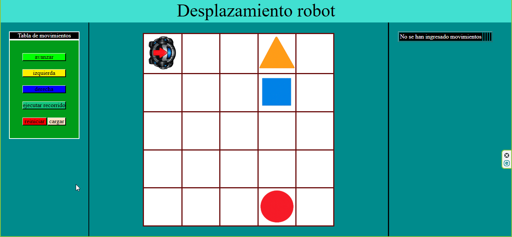

# Muévete con Guali (Versión Web)

-yellow?style=flat-square)


> **Origen del Proyecto:** Esta aplicación nace como una migración a tecnologías web (HTML, CSS y JavaScript puro) de mi proyecto universitario desarrollado originalmente en **Java (Swing)** para el curso de *Programación 1* en la Universidad Mariano Gálvez de Guatemala (UMG).  
> **Versión original de escritorio:** [Muévete con Guali (Java Swing)](https://github.com/canahuii/muevete_con_guali)

## Vista Previa



Adaptación web interactiva de **Muévete con Guali**, un simulador educativo diseñado para enseñar fundamentos de lógica secuencial, pensamiento crítico y conceptos espaciales mediante la programación de los movimientos de un robot en una cuadrícula.

---

##  Objetivo de la Aplicación

El usuario debe guiar a **Guali** (el robot) a través de un tablero cuadriculado utilizando una secuencia de instrucciones básicas (`Avanzar`, `Girar a la izquierda`, `Girar a la derecha`) para pasar sobre los objetivos generados aleatoriamente en el tablero (máximo tres objetos únicos en forma y color) sin salirse de los límites.

---

##  Funcionalidades Implementadas (v0.1 - Interfaz y Tablero)

- **Tablero Cuadriculado Responsivo:** Renderizado dinámico de la cuadrícula de juego manteniendo proporciones cuadradas.
- **Panel de Controles:** Botones interactivos para ingresar instrucciones de desplazamiento (`Avanzar`, `Izquierda`, `Derecha`), ejecución y reinicio.
- **Posicionamiento Inicial (`Reiniciar`):** Inicialización automática al cargar la página para generar el estado base del tablero, el robot y los objetos.
- **Área de Secuencia e Historial:** Panel dedicado para visualizar los movimientos ingresados y preparar el registro de intentos.

---

## Próximas Mejoras (Roadmap)

Actualmente el proyecto cuenta con su estructura visual y posicionamiento inicial. Las siguientes funcionalidades están en proceso de implementación:

- [ ] **Lógica de desplazamiento y rotación:** Actualizar coordenadas `(fila, columna)` y orientación del robot (`Norte`, `Sur`, `Este`, `Oeste`) paso a paso.
- [ ] **Ejecución animada (`Ejecutar recorrido`):** Recorrer la cola de instrucciones ingresadas con intervalos visuales.
- [ ] **Detección de objetos y colisiones:** Identificar forma y color de cada figura capturada al pasar sobre ella y detectar salidas del tablero.
- [ ] **Mensajes de retroalimentación:** Mostrar alertas indicando cada objeto capturado y si la misión fue cumplida o fallida.
- [ ] **Historial de intentos (`Cargar`):** Registrar métricas de la sesión (misiones cumplidas, fallidas, tiempo más corto y más largo).
- [ ] **Refinamiento visual:** Ajustar contrastes de botones y pulir detalles de la interfaz.

---

## Tecnologías Utilizadas

- **HTML:** Estructura semántica del tablero, controles y paneles.
- **CSS:** Maquetación con Flexbox, diseño de cuadrícula y estados visuales de botones.
- **JavaScript (Vanilla):** Manipulación del DOM, manejo de eventos (`addEventListener`) y lógica del juego.

---

## Cómo ejecutarlo localmente

1. Clona este repositorio o descarga los archivos:
   ```bash
   https://github.com/canahuii/muevete-con-guali-web.git

2. Abre la carpeta del proyecto y ejecuta el archivo muevete-con-guali-web.html en tu navegador web favorito.

## Autor
Desarrollado por José Eduardo Canahuí — @canahuii

